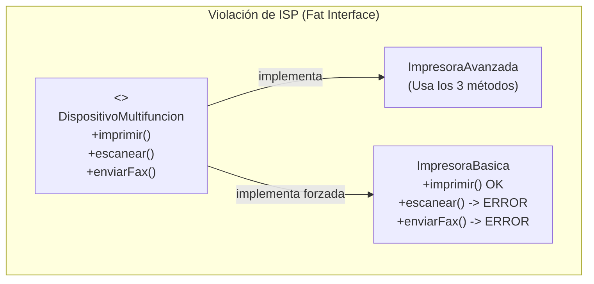
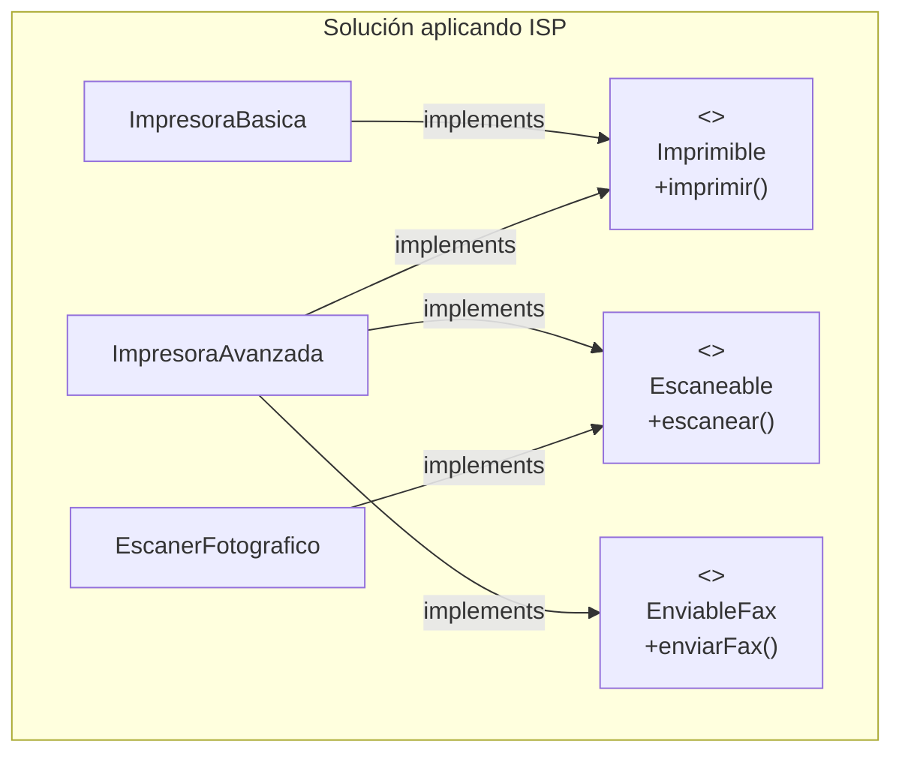

# 🎓 Exposición: Principio de Segregación de Interfaces (ISP)
**Asignatura:** Programación II  
**Institución:** Institución Universitaria Antonio José Camacho (UNIAJC)  
**Integrantes:** Carlos Esneider Espitia, Angel Cuenú, Kevin García  
**Rama:** `Espitia`

---

## 📌 Diapositiva 1: Portada
### Principio de Segregación de Interfaces (Interface Segregation Principle - ISP)
- **Tema:** Principios SOLID en el Diseño Orientado a Objetos.
- **Enfoque:** Alta cohesión, bajo acoplamiento y diseño de interfaces limpias y específicas para el cliente.
- **Expositor:** Carlos Esneider Espitia.

> **Notas del Expositor:**  
> "Buenos días profesor y compañeros. Hoy abordaremos la cuarta letra del acrónimo SOLID: el Principio de Segregación de Interfaces (ISP). Veremos por qué diseñar interfaces sobrecargadas o gigantescas es perjudicial para la arquitectura del software y cómo este principio nos ayuda a crear sistemas modulares, desacoplados y fáciles de mantener."

---

## 📌 Diapositiva 2: ¿Qué es el Principio de Segregación de Interfaces?
- Es la **"I"** de los principios **SOLID**, formulados por **Robert C. Martin ("Uncle Bob")**.
- **Definición Formal:**
  > *"Los clientes no deberían estar obligados a depender de interfaces que no utilizan."*  
  *(Clients should not be forced to depend upon interfaces that they do not use).*
- **Idea Clave:** Es preferible tener **muchas interfaces pequeñas y específicas de rol** (*Role Interfaces*) que **una sola interfaz general, monolítica y pesada** (*Fat Interface*).

> **Notas del Expositor:**  
> "En programación orientada a objetos, una interfaz representa un contrato. Si ese contrato incluye cláusulas que un cliente o clase no necesita o no sabe cómo cumplir, lo estamos atando innecesariamente a cambios ajenos. El ISP nos dice: divide ese gran contrato en acuerdos específicos y modulares."

---

## 📌 Diapositiva 3: El Problema: "Interfaces Gordas" (Fat Interfaces)
- **¿Qué es una Fat Interface?**  
  Una interfaz con demasiadas responsabilidades y métodos acumulados (violando también el Principio de Responsabilidad Única - SRP).
- **Consecuencias directas:**
  1. **Acoplamiento innecesario:** Los clientes conocen operaciones que no les conciernen.
  2. **Efecto dominó:** Si un método de la interfaz cambia (parámetros, retorno, firma), todas las clases que la implementan deben ser modificadas y recompiladas, incluso si jamás usaban ese método.
  3. **Fragilidad del código:** Rompe el polimorfismo genuino y genera comportamientos inesperados en tiempo de ejecución.

> **Notas del Expositor:**  
> "Imaginemos que en un restaurante nos obligan a firmar un contrato que incluye comer, pagar, cocinar, lavar platos y llevar la contabilidad, cuando nosotros solo fuimos a almorzar. Eso mismo ocurre cuando forzamos a una clase a implementar una interfaz sobrecargada."

---

## 📌 Diapositiva 4: Síntomas y "Code Smells" de Violación del ISP
¿Cómo detectar en nuestro código Java que estamos violando el ISP?

1. **Métodos vacíos ("Dummy Methods"):**  
   Implementaciones que solo tienen llaves vacías `{ }` o que retornan valores dummy (`null`, `0`, `false`).
2. **Lanzamiento forzado de excepciones:**  
   `throw new UnsupportedOperationException("Operación no soportada");`
3. **Comentarios de advertencia en el código:**  
   `// Este método no aplica para esta clase, ignorar.`
4. **Clientes que reciben notificaciones o fallos por cambios en funcionalidades que no utilizan.**

---

## 📌 Diapositiva 5: La Solución con ISP: Interfaces de Rol (Role Interfaces)
- **Descomposición:** Romper la interfaz monolítica en múltiples interfaces cohesivas basadas en capacidades o roles.
- **Composición en Java:** Java permite la **implementación múltiple de interfaces** (`implements Imprimible, Escaneable, EnviableFax`).
- Las clases ahora eligen con precisión **únicamente las capacidades que verdaderamente ejecutan**.

> **Notas del Expositor:**  
> "Al separar las interfaces en 'Imprimible', 'Escaneable' y 'EnviableFax', cada clase implementa solo lo que le compete. La impresora básica solo implementa Imprimible; la multifuncional implementa las tres. Y si mañana creamos un escáner que no imprime, solo implementa Escaneable sin arrastrar métodos basura."

---

## 📌 Diapositiva 6: Ejemplo Práctico 1 — Dispositivos de Oficina
*(Ubicado en el repositorio en: `src/com/uniajc/isp/ejemplo1_dispositivos/`)*

- **Escenario:** Gestión de periféricos en una red corporativa.
- **Problema (Violación):**
  - La interfaz `DispositivoMultifuncion` exige `imprimir()`, `escanear()` y `enviarFax()`.
  - La clase `ImpresoraEconomica` solo imprime físicamente. Al obligarla a cumplir el contrato, sus métodos `escanear()` y `enviarFax()` lanzan `UnsupportedOperationException`.
- **Solución con ISP:**
  - Creamos 3 interfaces granulares: `Imprimible`, `Escaneable`, `EnviableFax`.
  - `ImpresoraEconomica` implementa solo `Imprimible`.
  - `ImpresoraLaserAvanzada` implementa las tres.
  - `EscanerFotografico` implementa solo `Escaneable`.
- **Resultado:** Código limpio, sin excepciones ficticias, completamente seguro para polimorfismo.

---

## 📌 Diapositiva 7: Ejemplo Práctico 2 — Sistema de Trabajadores y Automatización
*(Ubicado en el repositorio en: `src/com/uniajc/isp/ejemplo2_trabajadores/`)*

- **Escenario:** Asignación de tareas a colaboradores humanos y robots autómatas en una fábrica o empresa de desarrollo.
- **Problema (Violación):**
  - La interfaz `Trabajador` define: `trabajar()`, `almorzar()`, `tomarDescanso()` y `asistirCapacitacion()`.
  - Un `RobotAutomata` trabaja incansablemente, pero **no almuerza ni toma descanso biológico**.
  - El robot queda contaminado con métodos que no tienen sentido semántico para él.
- **Solución con ISP:**
  - Interfaces de rol: `Trabajable` (labor), `Alimentable` (nutrición), `Descansable` (pausas), `Recargable` (mantenimiento eléctrico).
  - El `DesarrolladorHumano` implementa `Trabajable`, `Alimentable` y `Descansable`.
  - El `RobotAutomata` implementa `Trabajable` y `Recargable`.
- **Resultado:** Semántica precisa, alta extensibilidad y modelos de dominio consistentes.

---

## 📌 Diapositiva 8: Relación del ISP con otros Principios SOLID
1. **Con el Principio de Responsabilidad Única (SRP):**  
   Si una interfaz tiene demasiados métodos no relacionados, viola SRP en el nivel de abstracción. Segregar interfaces promueve la responsabilidad única.
2. **Con el Principio de Sustitución de Liskov (LSP):**  
   Cuando una clase lanza `UnsupportedOperationException` para evadir un método forzado, rompe LSP porque no puede sustituir fielmente a la interfaz prometida. ISP evita que esto suceda.
3. **Con el Principio de Inversión de Dependencias (DIP):**  
   DIP nos dice que dependamos de abstracciones. ISP asegura que esas abstracciones sean mínimas y enfocadas, evitando depender de métodos irrelevantes.

---

## 📌 Diapositiva 9: Beneficios en la Industria y Proyectos Reales
- **Mantenibilidad:** Menor impacto al alterar contratos; los cambios quedan confinados a los clientes que realmente los usan.
- **Testabilidad (Testing con Mocks):** Crear pruebas unitarias y dobles de prueba (Mocks/Stubs con Mockito o JUnit) es mucho más simple porque no hay que simular decenas de métodos ajenos a la prueba.
- **Reusabilidad:** Las interfaces pequeñas actúan como componentes "Lego" combinables según las necesidades de cada entidad.
- **Legibilidad y Documentación:** La lista de interfaces implementadas describe con exactitud las verdaderas capacidades de la clase a simple vista.

---

## 📌 Diapositiva 10: Regla Práctica (Checklist para el Desarrollador)
Antes de crear o modificar una interfaz, pregúntate:
- [ ] ¿Todas las clases que implementan esta interfaz necesitan el 100% de sus métodos?
- [ ] ¿Hay alguna clase que lance `UnsupportedOperationException` o tenga métodos vacíos?
- [ ] ¿Si agrego un nuevo método aquí, obligaré a clases no relacionadas a actualizarse?
- [ ] ¿Puedo descomponerla en contratos más específicos por rol de uso?

> 💡 **Regla de Oro:** *"Una interfaz debe ser tan pequeña como sea posible, pero no más pequeña de lo que tenga sentido funcional."*

---

## 📌 Diapositiva 11: Conclusiones
1. El Principio de Segregación de Interfaces busca **especificidad de rol** frente al gigantismo de contratos generales.
2. Evita la polución de código con métodos vacíos o excepciones forzadas.
3. En Java, se aprovecha al máximo gracias a la implementación de múltiples interfaces.
4. Es un pilar fundamental para arquitecturas limpias, escalables y mantenibles en el tiempo.

---

## ❓ Preguntas y Espacio de Discusión
¡Muchas gracias por su atención!
- Repositorio y código fuente en GitHub: Rama `Espitia`
- Ejemplos ejecutables con demostración interactiva en consola.
