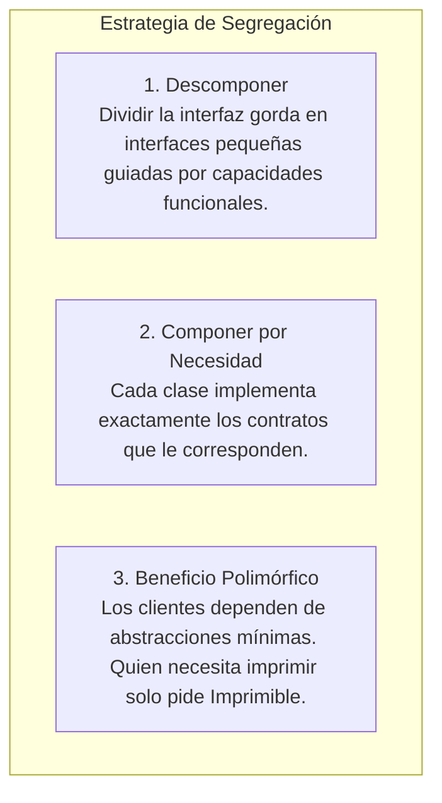
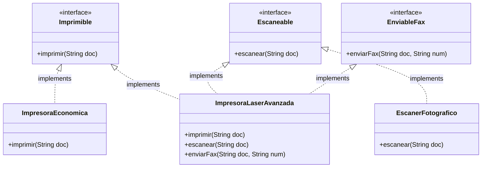
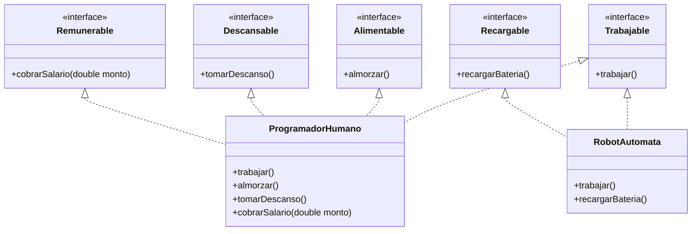

# Exposición: Principio de Segregación de Interfaces (ISP)

**Integrantes:**
- Carlos Espitia
- Angel Cuenú
- Kevin García

---

## 📌 Introducción al Principio de Segregación de Interfaces (ISP)

El **Principio de Segregación de Interfaces (Interface Segregation Principle - ISP)** es el cuarto principio del estándar **SOLID** en el diseño de software orientado a objetos. Su premisa fundamental dicta:

> *"Los clientes no deben verse obligados a depender de interfaces o contratos que no utilizan."*

Cuando diseñamos interfaces demasiado amplias (conocidas como **"Interfaces Gordas"** o *Fat Interfaces*), obligamos a las clases implementadoras a incluir métodos que no tienen sentido para su dominio o capacidades físicas, desembocando en métodos vacíos o excepciones en tiempo de ejecución (`UnsupportedOperationException`).

---

## 💡 La Solución: Interfaces de Rol (*Role Interfaces*)

La alternativa arquitectónica correcta consiste en **segregar contratos generales en acuerdos específicos, cohesivos y desacoplados**.



### Principio de Robustez
> **Ninguna clase se ve obligada a fingir capacidades que no tiene.** El sistema es seguro en tiempo de compilación y libre de excepciones forzadas en tiempo de ejecución.

---

## 📁 Estructura del Proyecto

```text
src/
└── com/
    └── uniajc/
        └── isp/
            ├── ejemplo1_dispositivos/
            │   ├── violacion/
            │   │   ├── DispositivoMultifuncion.java  (Interfaz Gorda)
            │   │   ├── ImpresoraEconomica.java        (Métodos con UnsupportedOperationException)
            │   │   ├── ImpresoraLaserAvanzada.java    (Implementación completa)
            │   │   └── MainViolacion.java             (Demostración ejecutable de fallo en runtime)
            │   └── solucion/
            │       ├── Imprimible.java                (Interfaz de Rol: imprimir)
            │       ├── Escaneable.java                (Interfaz de Rol: escanear)
            │       ├── EnviableFax.java               (Interfaz de Rol: enviarFax)
            │       ├── ImpresoraEconomica.java        (Solo implements Imprimible - 0 métodos basura)
            │       ├── ImpresoraLaserAvanzada.java    (implements Imprimible, Escaneable, EnviableFax)
            │       ├── EscanerFotografico.java        (Solo implements Escaneable)
            │       └── MainSolucion.java              (Demostración polimórfica tipada y segura)
            └── ejemplo2_trabajadores/
                ├── violacion/
                │   ├── Trabajador.java                (Interfaz Gorda: trabajar, almorzar, descansar, cobrar)
                │   ├── ProgramadorHumano.java         (Humano)
                │   ├── RobotAsistente.java            (Robot forzado a fingir almorzar/cobrar)
                │   └── MainViolacion.java             (Fallo en tiempo de ejecución en hora de almuerzo)
                └── solucion/
                    ├── Trabajable.java                (Interfaz de Rol: trabajar)
                    ├── Alimentable.java               (Interfaz de Rol: almorzar)
                    ├── Descansable.java               (Interfaz de Rol: tomarDescanso)
                    ├── Remunerable.java               (Interfaz de Rol: cobrarSalario)
                    ├── Recargable.java                (Interfaz de Rol: recargarBateria)
                    ├── ProgramadorHumano.java         (implements Trabajable, Alimentable, Descansable, Remunerable)
                    ├── RobotAutomata.java             (implements Trabajable, Recargable)
                    ├── GestorDeTareas.java            (Subsistema: solo pide Trabajable)
                    ├── Cafeteria.java                 (Subsistema: solo pide Alimentable)
                    ├── SistemaNomina.java             (Subsistema: solo pide Remunerable)
                    ├── EstacionDeCarga.java           (Subsistema: solo pide Recargable)
                    └── MainSolucion.java              (Demostración ejecutable de desacoplamiento empresarial)
```

---

## 🖨️ Ejemplo 1: Dispositivos de Oficina

**Ubicación en el repositorio:** `src/com/uniajc/isp/ejemplo1_dispositivos/`

### ❌ Violación: Interfaz Gorda
Una sola interfaz `DispositivoMultifuncion` reúne `imprimir()`, `escanear()` y `enviarFax()`.
Una `ImpresoraEconomica` que solo imprime en papel se ve obligada a implementar el escáner y el fax, arrojando excepciones `UnsupportedOperationException`.

```java
// VIOLACIÓN
public interface DispositivoMultifuncion {
    void imprimir(String doc);
    void escanear(String doc);
    void enviarFax(String doc, String num);
}

public class ImpresoraEconomica implements DispositivoMultifuncion {
    public void imprimir(String doc) { /* OK */ }
    public void escanear(String doc) { throw new UnsupportedOperationException("No soportado"); }
    public void enviarFax(String doc, String num) { throw new UnsupportedOperationException("No soportado"); }
}
```

###  Solución con ISP: Interfaces Segregadas
Descomponemos en 3 interfaces de rol: `Imprimible`, `Escaneable` y `EnviableFax`.



* **`ImpresoraEconomica`:** implementa `Imprimible` (0 métodos basura).
* **`ImpresoraLaserAvanzada`:** implementa `Imprimible`, `Escaneable`, `EnviableFax`.
* **`EscanerFotografico`:** implementa `Escaneable` (solo digitaliza).

---

## 🤖 Ejemplo 2: Trabajadores vs Robots Autónomos

**Ubicación en el repositorio:** `src/com/uniajc/isp/ejemplo2_trabajadores/`

### ❌ Violación: Forzar Métodos Absurdos
La interfaz `Trabajador` mezcla aspectos laborales con necesidades fisiológicas humanas:
`trabajar()`, `almorzar()`, `tomarDescanso()` y `cobrarSalario()`.
Un `RobotAsistente` no come ni cobra salario bancario, forzando código inválido.

```java
// VIOLACIÓN
public interface Trabajador {
    void trabajar();
    void almorzar();
    void tomarDescanso();
    void cobrarSalario(double monto);
}
```

###  Solución con ISP: Desacoplamiento Empresarial
Segregamos en interfaces de rol y desacoplamos los subsistemas de la empresa:



### Desacoplamiento Empresarial por Subsistemas:
- **Gestor de Tareas:** Solo solicita `Trabajable` (asigna labor a humanos y robots por igual).
- **Cafetería:** Solo solicita `Alimentable` (imposible enviar a un robot a almorzar por error en tiempo de compilación).
- **Sistema de Nómina:** Solo solicita `Remunerable` (paga a humanos).
- **Estación de Carga Eléctrica:** Solo interactúa con `Recargable` (recarga robots).

---

## 🚀 Compilación y Ejecución de los Ejemplos

### 1. Compilar todo el proyecto:
```bash
javac -d bin src/com/uniajc/isp/ejemplo1_dispositivos/*/*.java src/com/uniajc/isp/ejemplo2_trabajadores/*/*.java
```

### 2. Ejecutar Ejemplo 1 (Dispositivos de Oficina):
* **Violación (genera excepción en runtime):**
  ```bash
  java -cp bin com.uniajc.isp.ejemplo1_dispositivos.violacion.MainViolacion
  ```
* **Solución (flujo polimórfico limpio y seguro):**
  ```bash
  java -cp bin com.uniajc.isp.ejemplo1_dispositivos.solucion.MainSolucion
  ```

### 3. Ejecutar Ejemplo 2 (Trabajadores vs Robots):
* **Violación (genera excepción al forzar almorzar a un robot):**
  ```bash
  java -cp bin com.uniajc.isp.ejemplo2_trabajadores.violacion.MainViolacion
  ```
* **Solución (desacoplamiento empresarial tipado en Java):**
  ```bash
  java -cp bin com.uniajc.isp.ejemplo2_trabajadores.solucion.MainSolucion
  ```
